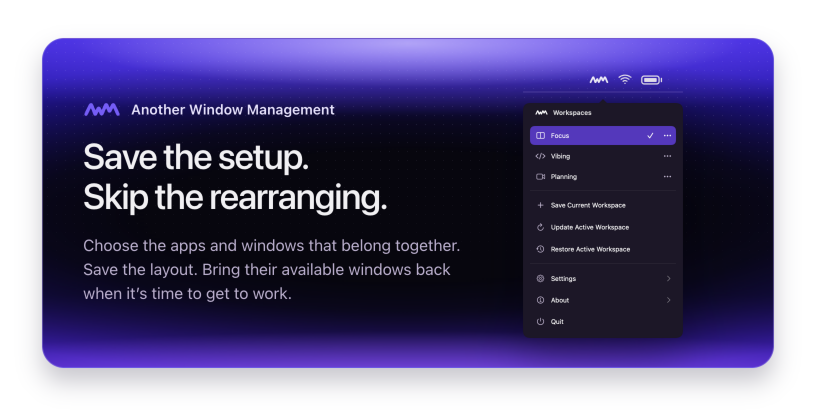

<h1> Another Window Management</h1>

Another Window Management is a macOS menu bar utility for saving and restoring window layouts. It runs from the menu bar on macOS 13 or later.

  

## Install

Check [GitHub Releases](https://github.com/mihaliak/awm/releases) for app downloads under **Assets**, or [build from source](BUILDING.md#build-and-run). Move **Another Window Management.app** to **Applications**, open it, and look for its icon in the menu bar.

## Features

| Feature | What you can do |
| --- | --- |
| Saved workspaces | Choose which apps and windows to save, then restore their layout from the menu bar or a shortcut. |
| Window shortcuts | Move, resize, center, or fill a window with configurable keys, sizing cycles, and gaps. |
| Multiple displays | Associate workspaces with display arrangements and optionally restore them when displays change. |
| Local backups | Copy `~/.awm.yaml` to back up layouts, shortcuts, and preferences. |

## Save a workspace

1. Choose **Allow Window Control…** in the menu bar popover. In **Privacy & Security → Device Control and Data Access** (**Accessibility** on older macOS), turn on **Another Window Management**. If the app is missing, use **+** to add the copy shown in Finder. Reopen AWM and choose **Let’s start** when setup succeeds.
2. Arrange the windows you want, open the menu bar popover, and choose **Save Current Workspace**. Enter a name, choose an icon, and check the apps and windows to include, then choose **Save**. Use **Update Active Workspace** or the update button under **Manage Workspace** to review the selection before replacing a layout.
3. Select a workspace to restore it. Use its ellipsis to open **Manage Workspace**. Choose **Move Up** or **Move Down** to change its position in the list. You can also rename it, change its icon, update its layout, set a shortcut, or delete it there.

macOS can require a fresh grant when a changed ad hoc build replaces the installed app. Signing with a consistent certificate lets the app keep its signing identity across builds.

The app captures supported windows visible on the current Spaces. Each saved position can be filled by an available window from the same app. With **Show apps and windows during restore** enabled, it shows hidden apps and restores minimized windows. It can also ask a running app to reopen, as when you click its Dock icon, if macOS reports a withdrawn window or the app is running with no windows. The running app decides whether to show an existing window, open a default window, or do nothing. A Dock-style reopen cannot restore a specific closed document. **Launch missing apps** separately controls whether the app starts apps that have quit. If a saved display is unavailable, the app fits affected windows onto the primary display and keeps the saved display arrangement for the next restore.

In **Display & Workspace Behavior**, enable automatic restoration and select a workspace for each arrangement you want to restore automatically. **General Preferences** controls login and restoration at launch.

## Default shortcuts

| Shortcut | Action |
| --- | --- |
| ⌥⌘← | Left align and cycle through ⅓, ⅔, and ½ widths |
| ⌥⌘→ | Right align and cycle through the same widths |
| ⌥⌘↑ | Top align at full width and cycle through ⅓, ⅔, and ½ heights |
| ⌥⌘↓ | Bottom align at full width and cycle through the same heights |
| ⌥⌘ Enter | Alternate between an almost-full centered size and filling the usable display within the window gap |
| ⌥⌘C | Center the focused window on its display without resizing |

Change the keys in **Keyboard Shortcuts**. In **Window Sizing**, adjust each edge’s size cycle and set **Window gap** as a percentage (0–8% of the usable width or height) or in points (0–128 pt). Points use the same distance on both axes, capped at 8% of the shorter usable display dimension. The app remembers the amount for each unit. The gap applies to every tile size and to fill, with one gap between adjacent tiles. For example, align a one-third-wide window to one side, then use ⌥⌘C on another one-third-wide window to place it in the middle with the same gap. **Centered window margin** remains a percentage and uses the window gap as its minimum on each axis.

## Back up or restore your workspaces

The app stores its workspaces in `~/.awm.yaml` with owner-only read and write permissions. The file contains workspace names, icons, selected apps, window and display geometry, placement order, display associations, shortcuts, preferences, and the last active workspace. Bundle IDs let macOS find and launch the selected apps. For apps without a bundle ID, AWM uses their application path for launch or their name for matching when no path is available.

AWM uses fingerprints to match connected displays and local slot IDs to reference saved positions. All layouts in the file share one salt, which travels with the backup so the fingerprints remain usable. Anyone with the file can see the salt and test guesses.

To restore a backup, quit Another Window Management, replace `~/.awm.yaml` with the backup, and reopen it. Use System Settings to manage macOS permissions.

The app appends one JSON record per failure to `~/.awm.error.log` with owner-only permissions. Records include the UTC timestamp, operation and reason, plus the workspace name, app name or bundle ID, window title and window slot when available. Window titles can contain document names or other private text. Review the log before sharing it.

## License

Another Window Management is source-available for noncommercial use. You may build, modify, fork, and share it for free under the [Another Window Management Noncommercial License](LICENSE). Commercial use and resale are prohibited, including for modified versions. Distributed forks and builds must credit Andrej Mihaliak and Another Window Management and link to this repository. Third-party material remains subject to its own terms.
